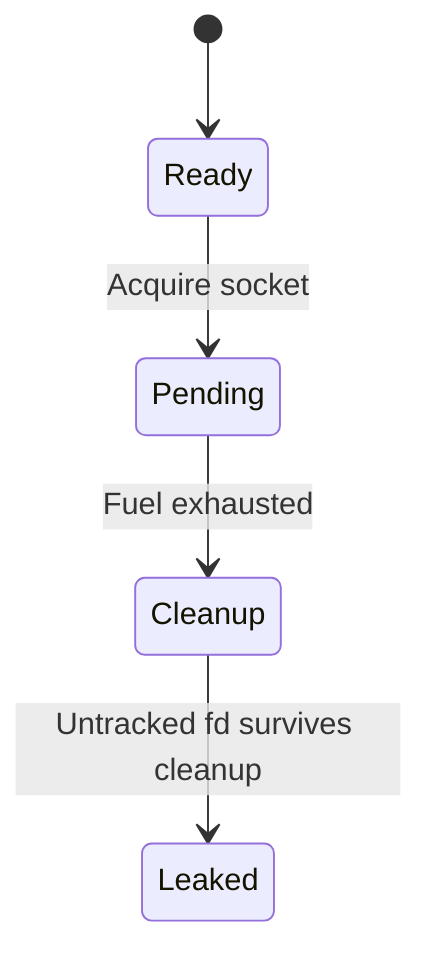

# Native state-model verification, 2026-11-22

Both requested TLA+ models are implemented and checked. Eleven deliberate model defects violate their named
invariants. Eleven corresponding real C mutations are rejected by concrete witnesses under optimized and
ASan/UBSan builds. The operation model also exposed a current implementation defect, reproduced before fixing:
a socket could remain open during fault cleanup if fuel failed before its handle was published.
Compiler/extension 1.7.1 correct that ownership gap; language core/1.7, checked format 1.0 and native ABI 1
are unchanged. No new source syntax, identity migration or runtime dependency is introduced.

[Model contract, source mapping and runnable command](../../verification/native/README.md),
[coverage fingerprints](../../verification/native/coverage.json),
[decision 0049](../../decisions/0049-native-state-models-and-pending-descriptor-cleanup.md) and
[structured receipt](2026-11-22-native-formal-verification.json) define the result. The earlier
[proposal](../../research/native-formal-verification-plan-2026-11-22.md) and
[1.7 engineering result](2026-11-22-native-boundary.md) remain historical checkpoints.

## Completed model checks

| Model | Selected configuration | Distinct states | Result |
| --- | --- | ---: | --- |
| Authority | 3 slots, generations 1..2, live limit 3, 5 calls, 4 permission atoms, full root grants | 11,991 | All configured safety invariants hold; queue empty |
| Operations | Fuel 4, payload 2, reservation quota 6, timeout 2 ticks | 1,815 | Safety and stated EventuallyDone property hold; queue empty |

TLC tools 1.7.4 / TLC 2.19 rev 5a47802 run with one worker, seed 1, fingerprint polynomial 0 and a 512 MiB
heap. The installed jar SHA-256 is pinned; SHA-1 matches the official release checksum. Java 11 and existing
Clang/LLVM tools were used. No tool installation or fallback occurred. Raw logs retain generated-state counts,
action coverage, queue sizes, fingerprint collision estimates and temporal-check completion. Every required
baseline action has nonzero successor coverage. No VIEW, symmetry quotient or state-pruning constraint is
used for the acceptance models. These are finite checks, not TLAPS proofs or cutoff theorems.

Authority checks entry-only root access, subset delegation, kind/generation validation, denied OS access,
handle quota, generation retirement and exit cleanup. Operations separates acquisition and publication,
validates connected peers, reserves requested IO bytes before short transfers, holds deadlines fixed within
a call and restarts them between calls, models interruption/fault/OS errors and checks drain-before-EOF.
Weak fairness excludes infinite artificial stuttering in the bounded operation driver. It does not promise
termination of arbitrary Lobo applications. The source mapping explicitly distinguishes returned errors,
language faults, invocation cleanup and subsequent kernel process teardown.

## A real counterexample and failing-before test

The legacy untracked-fault configuration starts with zero fuel and finds this three-step path:

1. Acquire a connect socket while it has no registry handle.
2. Fail the first wait because fuel is exhausted.
3. Run invocation cleanup; the unregistered descriptor remains open.

The shortest invariant trace contains the initial state plus those three transitions. Replaying it against
the actual C provider failed `formal_counterexample_fault_before_handle_publication_closes_pending_descriptor`:
the exit observer reported `descriptor leak at fault exit`, exit code 2 instead of the expected classified
fuel fault and completed cleanup. That failing-before test ran on the uncorrected provider. The process's
kernel teardown would eventually close the descriptor; the defect violated the stronger documented promise
that invocation cleanup closes owned descriptors before arena release and other exit observers.

The corrected provider records one pending fd during synchronous connect. Explicit error returns discard it;
publication transfers ownership to the registry; cleanup closes either owner without using fuel/call budget.
The focused test now passes in optimized and sanitizer builds, with native calls also exhausted at the fault.
The exact preserved 1.7.0 provider was also recompiled against the new witness and failed in both builds.
Removing the pending assignment in isolated C copies reproduces rejection in both builds. Production source
is never modified by the mutation checker.

## Deliberate defects and concrete C witnesses

| Model mutant | Expected violated invariant | Concrete C witness |
| --- | --- | --- |
| root | EntryAuthority | Cached root requested at nested call depth |
| amplify | NoAmplification | Empty derived parent attempts to grant a missing clock bit |
| stale | ValidGeneration | Close socket, reuse its slot, then read via old token |
| kind | ValidKind | Capability passed as a stream |
| denied | NoDeniedSyscall | Empty child capability tries listen under a global listen grant |
| quota | WithinQuota | Root fills limit one; listener allocation must fail and close its fd |
| wrap | NoGenerationWrap | Real maximum generation must retire instead of reusing the slot |
| cleanup | ExitCloses | Cleanup with exhausted fuel/calls must close registered sockets |
| untracked-fault | ExitCloses | Fuel fault before connect-handle publication must close pending fd |
| publish | ValidatedPublication | EINTR without an established connection cannot publish a stream |
| deadline | FixedDeadline | Repeated interruption must not postpone the original timeout |

The quota mutant uses a configured live limit of one. Generation two in the model's retirement witness maps
to the real 56-bit maximum in C. Permissions, resource identities and requested kind use representative
concrete values, with those translations documented individually. These are handwritten C witnesses of the
same transition/property failures, not an automated interpreter of arbitrary TLC traces. No mechanical
refinement relation is claimed. The runner preserves raw variable states and action names so the translation
can be reviewed after changes.

All eleven model mutants fail with TLC's expected invariant-violation class. All eleven C mutants compile,
then fail the intended witness in both builds: 22 accepted concrete replays and 22 expected C rejections.
Compiler failure, crash, stale source, timeout and incomplete exploration cannot satisfy the gate. Structural
TypeOK, ownership, byte conservation, EOF and liveness checks have no separate one-to-one mutation claim.
The existing actual-IO, ABI, sanitizer, forged-handle and full permission-matrix tests remain additional evidence.

## Corrections and unsuccessful attempts

All available raw attempt logs and source snapshots are retained in
`benchmarks/private-evidence/native-formal-20261122`. The receipt hashes their retained copies.

- The initial operation syntax had a comparison-precedence error; a later IF expression was evaluated as an
  integer conjunction. Both were model errors, corrected before claiming any check passed.
- The first operation abstraction omitted explicit closes on ordinary returned errors and produced a false
  leak path through OsFailure. Source review corrected it. The subsequent fuel-fault path, unlike that false
  model counterexample, reproduced against C before the fix.
- A proposed JSON trace-export flag was unsupported by the pinned TLC version. The checker instead preserves
  text traces and extracts action/raw-state records into JSON; it does not pretend to parse every TLA value.
- TLC rejected the first requested coverage interval. A supported interval of one is used, with final coverage
  checked for every intended baseline action.
- Preliminary operation models checked 298 states; the final reservation/per-call-deadline model checks 1,815.
  A smaller authority experiment checked 1,429 states before increasing the live limit to exercise chained
  delegation. These are intermediate configurations, not additional independent correctness samples.
- One chart command failed before execution because its log path was relative to the scratch directory.
  The corrected command used an absolute log path. The shell error is transcribed in the attempt notes.
- A reduced IO chart with fuel three could not reach successful EOF. The final display uses fuel four; the
  acceptance model independently requires nonzero Eof action coverage.
- A real negative checker test found that Python -O disabled acceptance assertions, allowing a deliberately
  broken baseline to be reported as passing. Explicit always-active checks replace those assertions. The full
  command now includes an actual-TLC optimized-Python self-test and rejects that same bad baseline. The
  checker test intentionally updates only its isolated fixture's coverage fingerprint to expose the acceptance
  bug rather than stopping at the separate source-drift guard. Production model/config files are untouched.
- The first structured trace extractor included TLC coverage statistics in the final state's text. A failing
  regression against a real TLC log exposed the excess payload; extraction now stops before those statistics.
  The negative checker self-test covers both optimization safety and clean counterexample state records.
- One real VS Code run logged an unexpected SIGPIPE but completed all test assertions and exited zero.
  A second fresh isolated host run completed without that warning. Both logs are preserved.

## Agent workflow and ordinary validation

The [new verification skill](../../.agents/skills/lobo-native-verification/SKILL.md) records the source mapping,
actual HEAD, uncommitted-source caveat, limits, one-command gate and maintenance procedure. A deliberately
modified covered file in a scratch copy is refused with `Coverage is stale for src/native_api.c`, exit 2.
The final command also applies isolated real C mutations and detects each one. Reviewed source hashes,
rather than an old HEAD alone, identify the implemented model/code pair. Do not refresh hashes without
reviewing whether the transitions still describe the code.

Run from the repository root, supplying an installed pinned jar:

```sh
TLA2TOOLS=/path/to/tla2tools.jar python3 scripts/check-native-models.py --out target/native-model-check-NEW
cargo test --locked
cargo clippy --locked --all-targets -- -D warnings
cargo fmt -- --check
npm --prefix editors/vscode run package
LOBO_VSCODE_EXECUTABLE=/usr/share/code/code xvfb-run -a npm --prefix editors/vscode run test:host
```

Final conventional checks pass 262 Rust test functions, 161 editor tests, 31 Python benchmark-tool tests,
four codemod tests and six existing HTTP acceptance tests. The focused C replays are part of normal Cargo
without a Java dependency. Both local skills validate. Optimized tools and VSIX are rebuilt as 1.7.1;
release-native examples and skill programs run through both backends. Existing MVC checked programs retain
their identities and behavior. Documentation/link and integrity checks accompany the receipt. Test counts
are engineering cases, not independent research subjects or a measured security score.

## Model-generated views

The `/statechart` workflow reviewed every mutant's result and generated the preserved shortest invariant
paths. Display configurations are reduced separately: authority uses two slots, one generation, two calls
and listen-only grants (33 states); operations uses fuel four, payload one, quota three and timeout one
(465 states). Acceptance uses the larger configurations in the table above. These views merge reader-facing
labels and omit within-label steps; raw reports preserve the omitted counts. They do not replace the full
model check. The fault path below shows the legacy untracked variant, not corrected behavior:



Normal control-flow charts and every mutant's report/diagram are retained with the local statechart artifacts.
The corrected operation model reaches a closed descriptor at completion. No diagram is a C memory-safety proof.

## Limits and paper interpretation

The bounded models omit C pointers/undefined behavior, arbitrary kernel semantics, malicious native code,
real concurrency, process signals, random entropy quality and the whole compiler's ABI/type system. Syscalls
return in the model; successful IO follows the stated FIFO/count abstraction. Abstract fuel does not count
all generated source-expression ticks. The two models are checked separately; no compositional/unbounded
proof connects them to every 64-slot, 56-bit execution. The authority model's full root grants do not by
themselves exhaust every launch policy; the actual C permission-matrix/default-deny tests cover additional
cases. Byte contents, zero-length read semantics, invalid scalar arguments, requests exceeding a positive
remaining quota and arbitrary address policies remain in concrete tests.

This is development verification and one reproduced contract correction. Agent construction, comprehension,
token efficiency, production security and runtime performance effects remain unmeasured. No sustained fuzz
campaign or independent security audit occurred. The ignored local archive is not a commit, publication or
off-device backup. Earlier paper entries, frozen research fixtures, release artifacts and identity values
remain preserved; their original limitations still apply.
